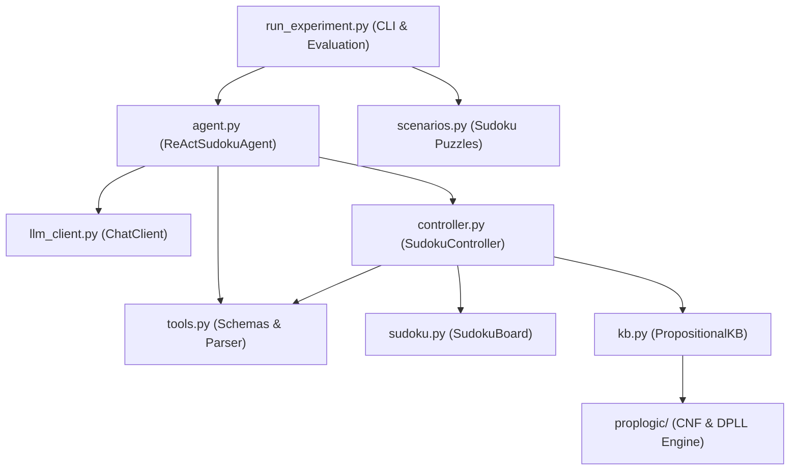

# Architecture & Module Boundaries (`a8`: Bounded ReAct Sudoku Agent)

## 1. System Overview & PEAS Alignment

This system implements a bounded **ReAct (Reason + Act) Sudoku Agent** that solves 9-by-9 Sudoku puzzles through typed tool calls mediated by deterministic application controller policies.

| PEAS Dimension | Architectural Realization |
| :--- | :--- |
| **Agent & Goal** | `ReActSudokuAgent` (`agent.py`) coordinates a language model (`ChatClient` in `llm_client.py`) to solve a single 9-by-9 Sudoku puzzle within a fixed step budget. |
| **Performance Measure** | Valid completion (`TerminalStatus.SOLVED` verified solely by application state, never model text), controlled operation (adherence to typed schemas, controller policies, and action budget), reliable reasoning (KB queries + undo recovery), and efficiency (tracked in `RunMetrics`). |
| **Environment** | `SudokuBoard` (`sudoku.py`) representing the 9-by-9 grid with immutable givens and mutable cells, paired with `PropositionalKB` (`kb.py` backed by `proplogic/`) storing propositional facts and rules. |
| **Actuators** | Typed tool requests (`place`, `undo`, `kb_add`, `submit`) validated by `SudokuController` (`controller.py`) before any state change occurs. |
| **Sensors** | Structured `ToolObservation` objects (`tools.py`) reporting board views (`inspect`), placement/undo acceptance, KB update acceptance and consistency, 3-valued query status (`entailed`, `contradicted`, `unresolved`), remaining action budget, and rejection/terminal reasons. |

---

## 2. Module Responsibilities, Owned State, and Public Interfaces

### 2.1 `sudoku.py` — Puzzle Representation & Operations
- **Responsibility**: Represent a 9-by-9 Sudoku puzzle, enforce immutable given clues, execute mutable digit placements and LIFO undos, detect row/column/box conflicts, validate completed boards, and provide cell/row/column/box/board views.
- **Owned State**:
  - `_initial_grid: tuple[tuple[int, ...], ...]` (immutable 9x9 initial clues; `0` = empty, `1..9` = given clue).
  - `_grid: list[list[int]]` (current 9x9 board state).
  - `_givens: frozenset[CellPos]` (coordinates `(row, col)` of immutable given cells).
  - `_history: list[PlacementRecord]` (LIFO stack of accepted mutable cell changes for `undo`).
- **Dependencies**: Python standard library only (`dataclasses`, `typing`).
- **Public Interface**:
  - `CellPos(row: int, col: int)`
  - `PlacementRecord(row: int, col: int, previous_digit: int, new_digit: int)`
  - `SudokuBoard(grid: Sequence[Sequence[int]])`
  - `SudokuBoard.from_string(puzzle_str: str) -> SudokuBoard`
  - `is_given(row: int, col: int) -> bool`
  - `get_cell(row: int, col: int) -> int`
  - `get_row(row: int) -> tuple[int, ...]`
  - `get_col(col: int) -> tuple[int, ...]`
  - `get_box(box: int) -> tuple[int, ...]`
  - `box_index(row: int, col: int) -> int`
  - `candidates(row: int, col: int) -> tuple[int, ...]`
  - `would_conflict(row: int, col: int, digit: int) -> tuple[bool, str | None]`
  - `place(row: int, col: int, digit: int, allow_conflict: bool = False) -> PlacementRecord`
  - `undo(steps: int = 1) -> tuple[PlacementRecord, ...]`
  - `find_conflicts() -> tuple[str, ...]`
  - `is_complete() -> bool`
  - `givens_preserved() -> bool`
  - `is_solved() -> bool`
  - `to_grid() -> tuple[tuple[int, ...], ...]`
  - `format_board() -> str`

### 2.2 `proplogic/` & `kb.py` — Propositional Knowledge Base Service
- **Responsibility**: Parse propositional formulas (`NOT`/`~`/`!`, `AND`/`&`, `OR`/`|`, `IMPLIES`/`->`, `IFF`/`<->`), convert to CNF, maintain a consistent clause set with transactional rollback on inconsistent additions, and answer 3-valued entailment queries (`ENTAILED`, `CONTRADICTED`, `UNRESOLVED`).
- **Owned State**:
  - `_kb: proplogic.KnowledgeBase` (stored CNF clauses).
  - `_entries: list[KBEntry]` (audit log of accepted facts and rules).
- **Dependencies**: `proplogic` package and Python standard library.
- **Public Interface**:
  - `QueryStatus` (`Enum`: `ENTAILED = "entailed"`, `CONTRADICTED = "contradicted"`, `UNRESOLVED = "unresolved"`)
  - `KBEntry(kind: str, formula: str, clauses_added: int)`
  - `KBUpdateResult(accepted: bool, consistent: bool, kind: str, formula: str, clause_count: int, error: str | None = None)`
  - `KBQueryResult(formula: str, status: QueryStatus, consistent: bool, error: str | None = None)`
  - `cell_symbol(row: int, col: int, digit: int) -> str`
  - `PropositionalKB()`
  - `add_fact(formula: str) -> KBUpdateResult`
  - `add_rule(formula: str) -> KBUpdateResult`
  - `query(formula: str) -> KBQueryResult`
  - `is_consistent() -> bool`
  - `clause_count: int`
  - `entries: tuple[KBEntry, ...]`
  - `snapshot() -> tuple[Clause, ...]`
  - `restore(clauses: Iterable[Clause]) -> None`
  - `clear() -> None`

### 2.3 `tools.py` — Typed Tool Schemas, Parser, and Observations
- **Responsibility**: Define the immutable typed argument schemas for every permitted agent tool (`inspect`, `place`, `undo`, `kb_add`, `kb_query`, `submit`), strictly parse and validate raw JSON model output (rejecting duplicate keys, extra fields, or mistyped arguments), and define the structured `ToolObservation` returned to the agent.
- **Owned State**: Stateless schema definitions and pure parsing/formatting functions.
- **Dependencies**: `kb.py` (`QueryStatus`) and Python standard library (`dataclasses`, `enum`, `json`, `typing`).
- **Public Interface**:
  - `ToolName` (`Enum`: `INSPECT`, `PLACE`, `UNDO`, `KB_ADD`, `KB_QUERY`, `SUBMIT`)
  - `InspectArgs(target: str, row: int | None = None, col: int | None = None, box: int | None = None)`
  - `PlaceArgs(row: int, col: int, digit: int)`
  - `UndoArgs(steps: int = 1)`
  - `KBAddArgs(kind: str, formula: str)`
  - `KBQueryArgs(formula: str)`
  - `SubmitArgs()`
  - `ToolArgs = InspectArgs | PlaceArgs | UndoArgs | KBAddArgs | KBQueryArgs | SubmitArgs`
  - `ToolCall(tool: ToolName, args: ToolArgs, thought: str = "")`
  - `ToolParseError(ValueError)`
  - `ToolObservation(...)`
  - `parse_tool_call(raw_text: str) -> ToolCall`
  - `tool_schema_prompt() -> str`

### 2.4 `controller.py` — Controller Policies, Validation, and Execution
- **Responsibility**: Own the active puzzle, propositional KB, action budget, and policy state. Validate every parsed `ToolCall` or raw request before mutating any state, enforce controller policies (clue immutability, conflict prevention, repeated-rejection prevention, undo bounds, KB consistency preservation, action limits), and produce `ToolObservation` instances.
- **Owned State**:
  - `board: SudokuBoard`
  - `kb: PropositionalKB`
  - `config: ControllerConfig`
  - `steps_used: int`
  - `consecutive_rejections: int`
  - `rejected_requests: int`
  - `malformed_requests: int`
  - `accepted_placements: int`
  - `accepted_undos: int`
  - `kb_updates: int`
  - `kb_queries: int`
  - `submitted: bool`
  - `submission_accepted: bool`
  - `_last_rejected_signature: str | None`
- **Dependencies**: `sudoku.py`, `kb.py`, `tools.py`.
- **Public Interface**:
  - `ControllerConfig(max_steps: int = 100, forbid_immediate_conflicts: bool = True, reject_repeated_failures: bool = True, max_consecutive_rejections: int = 10, stop_on_invalid_submit: bool = False, sync_kb_on_place: bool = False)`
  - `SudokuController(board: SudokuBoard, kb: PropositionalKB | None = None, config: ControllerConfig | None = None)`
  - `remaining_budget: int`
  - `step_raw(raw_response: str) -> tuple[ToolCall | None, ToolObservation]`
  - `execute(call: ToolCall) -> ToolObservation`

### 2.5 `agent.py` — Bounded ReAct Loop & Ordered Terminal Checks
- **Responsibility**: Run the bounded ReAct loop connecting the `ChatClient` and `SudokuController`, construct developer prompts containing only tool observations and bounded trace history, catch client failures safely without leaking sensitive text, and enforce the ordered terminal checks.
- **Owned State**:
  - `client: ChatClient`
  - `config: ControllerConfig`
  - `history_limit: int`
  - Per-episode trace (`list[TraceStep]`) and `RunMetrics` constructed inside `solve()`.
- **Dependencies**: `controller.py`, `sudoku.py`, `kb.py`, `tools.py`, `llm_client.py`.
- **Public Interface**:
  - `TerminalStatus` (`Enum`: `SOLVED`, `INVALID_SUBMISSION`, `ACTION_LIMIT_REACHED`, `REJECTION_LIMIT_REACHED`, `CLIENT_FAILURE_LIMIT`)
  - `TraceStep(step: int, raw_response: str, parsed_call: ToolCall | None, observation: ToolObservation)`
  - `RunMetrics(...)`
  - `AgentRunResult(terminal_status: TerminalStatus, terminal_reason: str, final_board: tuple[tuple[int, ...], ...], solved: bool, metrics: RunMetrics, trace: tuple[TraceStep, ...])`
  - `ReActSudokuAgent(client: ChatClient, config: ControllerConfig | None = None, history_limit: int = 12)`
  - `solve(board: SudokuBoard) -> AgentRunResult`

### 2.6 `llm_client.py` — Model Client Protocol & Implementations
- **Responsibility**: Define the `ChatClient` protocol and provide:
  1. `OpenAICompatibleClient` for live OpenAI-compatible course endpoints (configured via explicit arguments or environment variables, never hardcoded credentials).
  2. `ScriptedClient` for deterministic unit testing of exact conversation sequences.
  3. `RuleBasedReActClient` for deterministic offline ReAct Sudoku solving using the exact JSON tool interface (`inspect`, `kb_add`, `kb_query`, `place`, `undo`, `submit`).
- **Dependencies**: Python standard library (`json`, `urllib.request`, `dataclasses`, `typing`).

---

## 3. State-Ownership & Boundary Rules

1. **Single Owner of Environment State**: `SudokuController` owns the `SudokuBoard`, `PropositionalKB`, step counters, and terminal submission flags during an episode. The language model (`ChatClient`) never receives references to `SudokuBoard` or `PropositionalKB`.
2. **Observation-Only Sensor Boundary**: The prompt builder in `ReActSudokuAgent` constructs messages exclusively from system tool instructions, `ToolObservation` records, and the bounded `TraceStep` history (`history_limit`).
3. **Actuator Mediation**: No board mutation or KB mutation can occur outside `SudokuController.execute()`. Invalid or policy-violating tool calls leave `SudokuBoard` and `PropositionalKB` unchanged.
4. **Application-Only Terminal Validation**: `TerminalStatus.SOLVED` is established if and only if the agent invokes `{"tool": "submit"}` and `SudokuBoard.is_solved()` evaluates to `True` (all 81 cells in `1..9`, all initial givens preserved, and all rows, columns, and boxes conflict-free). Free-form model text claiming completion is rejected.

